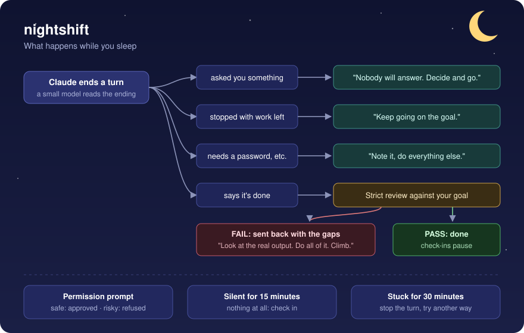
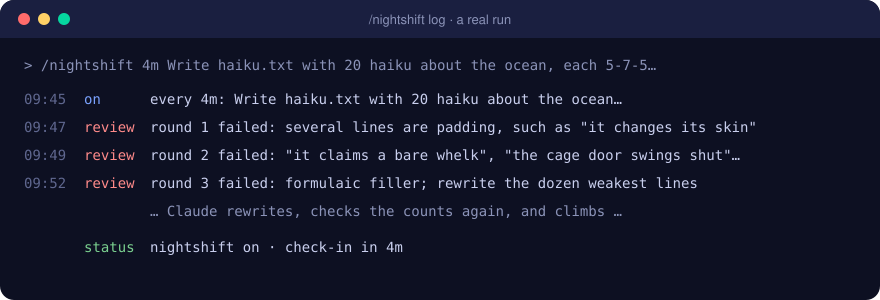

# nightshift

You tell Claude Code to work on its own and go to bed. When you wake up, it has spent the night waiting on a question it could have answered itself. Or it's stuck on a permission prompt. Or it said "done" at 1 a.m. with half the job left.

nightshift is a Claude Code plugin that keeps the session working while you're away.

```
/nightshift build the level editor, matching the mocks in docs/mocks
```



## What it does

- **Answers its own questions.** If Claude ends a turn asking you something, nightshift sends it back: nobody will answer, so make the call, write it down, and keep going. The question tool is switched off while it runs.
- **Keeps every task bounded.** Each task, and each helper agent Claude starts, gets a clear end: the steps, one check, at most two tries and a time limit. Then it reports, done or not. Check-ins catch any agent that keeps rerunning the same thing, and the reviewer sends open-ended loops back.
- **Cleans up after itself.** Whatever Claude or its helper agents start, they stop: dev servers, browsers, background jobs and temp files. Check-ins look for leftovers and stop them, and Claude never hands you a list of processes to kill.
- **Holds Claude to your goal.** When Claude says it's done, a strict reviewer checks the work against what you first asked for. The reviewer is a copy of the session with the whole conversation. Did every part get done, or only a sample? Did anyone actually look at the output, or only run the tests? Would you accept it next to your mock? If not, the work goes back with a list of gaps, up to 5 times. It only reviews when nothing is still running.
- **Settles permission prompts.** Only prompts that would really wait for you: your rules and auto mode decide first. Safe local steps are approved. Anything destructive or public is refused, with a reason, so Claude takes another route instead of waiting. Examples: force pushes, publishing, deploys, dropping databases, rebooting, sending messages.
- **Spends as little as it can.** Free options come first: your Claude Code subscription, local tools, models already set up. Cloud GPUs such as RunPod only when nothing free works: the cheapest machine that fits, at most $0.60 an hour, shut down right after each run. Check-ins look for paid machines left running, and the reviewer counts wasted money as a gap.
- **Stays quiet otherwise.** It only speaks up when Claude is stuck or off course. Waiting on its own agents isn't stuck: their reports wake Claude, so nightshift says nothing.
- **Checks in.** If nothing at all happens for 15 minutes (no turn, no tool call from any agent), it asks Claude what's stuck and gets it moving again.
- **Restarts stuck turns.** A turn with no activity for 30 minutes is stopped, and Claude is told to try another way.
- **Keeps a log** of everything it approved, refused and sent back, for the morning.



## Install

At the prompt of a Claude Code terminal session:

```
/plugin install nightshift --marketplace andrsnn/nightshift
```

From a shell:

```
claude plugin install nightshift --marketplace andrsnn/nightshift
```

nightshift is built on Claude Code's function-hooks plugin API, which is in early access. It was built and tested on Claude Code 2.1.316.

## Use

| Command | What it does |
|---|---|
| `/nightshift <goal>` | Turn it on. With no goal, it uses what you asked for earlier in the conversation. |
| `/nightshift 10m <goal>` | Turn it on and check in after 10 idle minutes instead of 15. |
| `/nightshift status` | Show whether it's on, idle or working. |
| `/nightshift log` | Show what it approved, refused and sent back. |
| `/nightshift off` | Turn it off. Typing anything yourself also resets its counters. |

It stays on when the session restarts.

The status line shows `nightshift on` while it runs, and `nightshift: goal done` once a review passes.

## Settings

Change these in `/config` under nightshift.

| Setting | Default | |
|---|---|---|
| Check-in interval | 15 minutes | How long the session may sit idle before a check-in. |
| Stall limit | 30 minutes | How long a turn may go with no activity before it's restarted. |
| Strict reviews per goal | 5 | How many times a "done" gets sent back before nightshift accepts it. |
| How you check work | empty | Your own bar, given to the reviewer. For example: "screenshot every screen and compare with the mock; run the game; read the copy out loud." |
| Money rules | free first; cloud GPUs at most $0.60/h, shut down after each run | What Claude may spend while you're away. |
| Extra deny patterns | empty | Regular expressions for commands it must never approve, separated by `;;`. |

## Where the reviewer's checks come from

The reviewer's checklist comes from a month of one developer's real sessions. In those sessions, 43% of replies to a "done" message were pushback, and in 138 of 199 "done" turns Claude hadn't opened a single image of what it built. The common reasons it was sent back:

- it did part of the job and called it done;
- there was no proof, only test counts and build numbers;
- the result was far below the mock;
- it asked for permission it already had;
- it drifted from what was asked.

The reviewer checks for each of these, and nightshift's instructions tell Claude to check them before it says done.

## Safety

nightshift approves prompts you'd otherwise answer yourself, so start it in a project where that's fine. It never approves:

- force pushes, hard resets and deleted branches;
- publishing, releases and deploys;
- dropping databases, formatting disks and recursive deletes of whole drives or home folders;
- reboots and shutdowns.

Anything else that a small model judges destructive or public is refused too. Rules you've set to deny stay denied.

Don't use plan mode with nightshift: nobody is there to approve the plan.

## Develop

```
claude plugin validate .
claude plugin test .
node scripts/live-check.mjs <empty folder> 300 "/nightshift 2m <goal>"
```

`live-check.mjs` runs a real headless session with the plugin loaded and prints each turn. In Git Bash, set `MSYS_NO_PATHCONV=1`, or `/nightshift` gets rewritten into a Windows path.

## License

MIT
